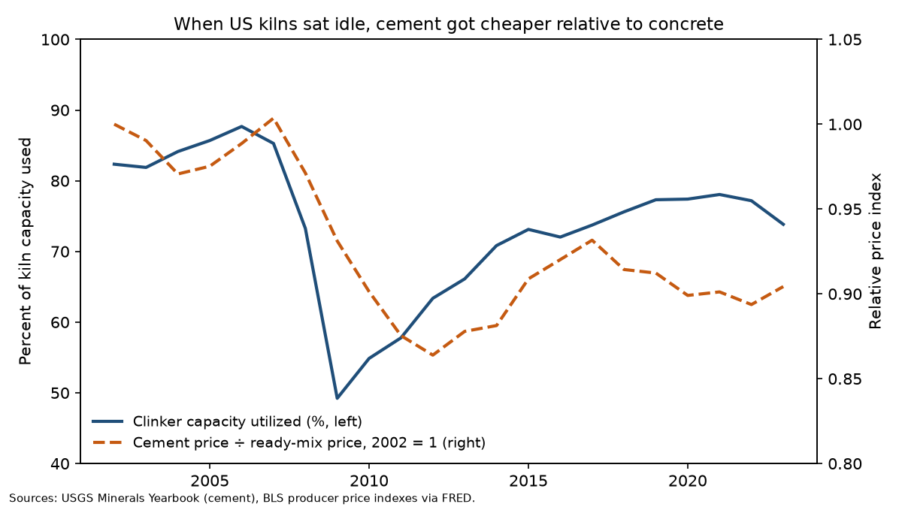
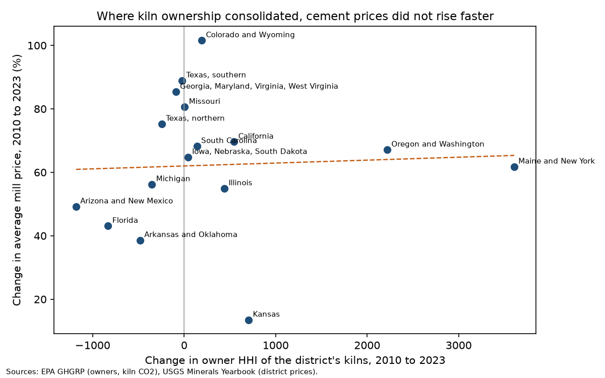

# Who Owns the Kilns

### In 1990, Oliver Hart and Jean Tirole worked out when a supplier buys its customers in order to shut their rivals out, and they pointed to cement as a case. I went back to the cement industry with data from 2002 to 2023 to see how the theory holds up.

---

A ton of portland cement left the mill at an average price of $151 in 2023, up from $91 in 2010. In 2023, 72% of
the cement shipped in the United States went to ready-mixed concrete producers, the companies whose drum trucks
deliver wet concrete to building sites. The rest went to makers of concrete block, pipe and precast products, to
contractors and building-material dealers, and to oil, mining and government buyers. If you live near Dallas, the cement in your new driveway most likely
came from the town of Midlothian, where Martin Marietta, Holcim and CRH each run a cement plant, three of the five
plants in the US Geological Survey's northern Texas district.

Cement is heavy and cheap for its weight, so it rarely travels far, and in any one region a few companies own the
kilns. Whether the company that owns the kiln should also own the concrete trucks is an old question. In the early
1960s American cement makers bought ready-mix companies by the dozen, and the Federal Trade Commission studied the
wave in a 1966 report. A quarter century later two economists at MIT, Oliver Hart and Jean Tirole, used that
episode to illustrate a theory of when buying a customer is a way of starving its rivals. Both later won the Nobel
Prize. The industry they wrote about has since been bought up by a handful of global groups, gone through a slump
that left half its kiln capacity idle, and consolidated again, which makes it a good place to check what their
theory predicts.

---

## Counting owners, and what a supplier cannot promise

The first measure is the one antitrust agencies use for concentration, the Herfindahl-Hirschman Index. With
$`s_i`$ the percentage share of firm $`i`$ in a market of $`N`$ firms,

```math
\text{HHI} = \sum_{i=1}^{N} s_i^{2}
```

In 2023 four companies owned the cement kilns in Missouri, the third-largest producing state. Measured by kiln
output, Holcim had 44.4%, Buzzi 36.3%, Eagle Materials 11.1% and Summit Materials 8.2%, so

```math
\text{HHI}_{\text{Missouri}} = 44.4^{2} + 36.3^{2} + 11.1^{2} + 8.2^{2} = 3{,}480
```

The 2023 Merger Guidelines issued by the Justice Department and the Federal Trade Commission call any market above
1,800 highly concentrated.

| Market | Calculation | HHI |
|---|---|---|
| One owner | 100² | 10,000 |
| Four equal owners | 4 × 25² | 2,500 |
| Twenty equal owners | 20 × 5² | 500 |

The second measure is how much of the industry's kiln capacity is running. Clinker is the gray nodule that comes out
of a cement kiln before it is ground into powder, and utilization in year $`t`$ is clinker produced over the
clinker the kilns could make in a year. In 2009 American kilns produced 56.1 million metric tons against a capacity
of 114 million.

```math
u_t = \frac{\text{clinker produced}_t}{\text{clinker capacity}_t}, \qquad u_{2009} = \frac{56.1}{114.0} = 49.2\%
```

The third idea is Hart and Tirole's. Picture a supplier with a monopoly on some input, selling to competing
retailers. If it could promise each retailer to sell the others only a limited amount, it could hold total output
to the monopoly level and collect the monopoly profit through its prices. But contracts between a supplier and its
customers are private. Once one retailer has signed, the supplier is tempted to sell a little more to another, and
the first retailer, knowing this, will not pay for a promise the supplier cannot keep. The supplier ends up selling
what competing retailers would sell, which is more than a monopolist would. With a straight-line demand curve and
$`n`$ retailers, the supplier collects only a fraction of the monopoly profit $`\pi^{m}`$.

```math
\frac{\pi^{\text{secret}}}{\pi^{m}} = \frac{4n}{(n+1)^{2}}, \qquad n = 2:\ \frac{8}{9} = 88.9\%
```

| Competing retailers | Share of monopoly profit the supplier collects |
|---|---|
| 1 | 100% |
| 2 | 89% |
| 10 | 33% |

If the supplier buys one of the retailers, the temptation disappears, because every extra unit it sells to a rival
now lowers the price its own retailer gets. The rival retailer is shut out, or in the paper's word, foreclosed.

---

## Hart and Tirole's question

Oliver Hart was born in London in 1948, studied mathematics at Cambridge and earned his doctorate at Princeton
in 1974. He came to MIT as a visitor in 1984, stayed for nearly nine years, and moved to Harvard in 1993. Jean Tirole
was born in Troyes, France, in 1953, trained as an engineer at the École Polytechnique, and took his economics
doctorate at MIT in 1981 under Eric Maskin. He taught at MIT from 1984 to 1991 and then settled in Toulouse, where
he helped build what became the Toulouse School of Economics. The two were colleagues at MIT when they wrote
"Vertical Integration and Market Foreclosure" for the 1990 Microeconomics volume of the *Brookings Papers on
Economic Activity*. Tirole received the Nobel Prize in 2014 for his analysis of market power and regulation, and
Hart shared the 2016 prize with Bengt Holmström for their work on contract theory.

The paper was written against a confident argument from Chicago, which it quotes in Richard Posner and Frank
Easterbrook's words, that "there is only one monopoly profit to be made in a chain of production." On that view a
monopolist gains nothing by buying its customers. Hart and Tirole showed that the argument assumes the monopolist
can commit to restricting its own sales. The core of the proof fits in a few lines. Take inverse demand
$`P = a - bQ`$, a supplier with marginal cost $`c`$, two retailers that resell one-for-one, and secret contracts.
Each retailer expects its rival to receive the quantity $`q^{*}`$, so the best it can do is buy its own best reply,
and the supplier, unable to promise anything else, sells it. That is the Cournot outcome. A merged supplier and
retailer instead maximize joint profit and sell nothing to the rival.

```math
\begin{aligned}
\text{secret contracts:}\quad & q^{*} = \arg\max_{q}\,\big[a - b(q + q^{*}) - c\big]\,q \\
& \Rightarrow\; q^{*} = \frac{a-c}{3b},\qquad Q = \frac{2(a-c)}{3b} \\
& \pi^{\text{secret}} = (a - bQ - c)\,Q = \frac{2(a-c)^{2}}{9b} \\
\text{after merging:}\quad & q^{m} = \arg\max_{Q}\,(a - bQ - c)\,Q = \frac{a-c}{2b} \\
& \pi^{m} = \frac{(a-c)^{2}}{4b} \\
\Rightarrow\quad & \frac{q^{m}}{Q} = \frac{3}{4},\qquad \frac{\pi^{\text{secret}}}{\pi^{m}} = \frac{8}{9}
\end{aligned}
```

In words, integration cuts output by a quarter and lets the supplier collect the monopoly profit that secrecy had
denied it, and the paper's footnote 24 records the matching surplus figures of 4/9 and 3/8 of $`(a-c)^2/b`$. They
built two more versions, called scarce needs and scarce supplies, in which a merger steers trade toward the merging
partner and, if the rival on the other side is squeezed out of the industry, leaves the market monopolized anyway.

For the cement case they chose scarce needs. Cement makers had built too much capacity in the late 1950s.
Utilization had been 94% in 1955 and fell to 74% by 1960, capacity grew 60% between 1955 and 1965, twice as fast as
shipments, and 37 of the 55 vertical acquisitions studied took place in markets with more spare capacity than
average. With idle kilns, the scarce thing was a reliable buyer, so cement companies bought the largest ready-mix
firms to lock up outlets, and the acquired ready-mix companies raised the share of cement they bought from their
new parents from 37% to 69%. In the late 1950s, when cement was tight, integration had run the other way, with
large concrete makers building their own kilns.

The first objection came from the paper's own discussants. Oliver Williamson argued that the model needed both
stages of the industry to be concentrated and the bottleneck to be real, and he doubted that 1960s cement passed
either test. The strongest empirical answer came seventeen years later, when Ali Hortaçsu and Chad Syverson used
confidential Census records on cement and ready-mix plants spanning several decades. When local markets became
more integrated, prices fell, quantities rose and entry did not slow, and integrated firms were simply
more productive, a pattern of efficiency rather than foreclosure. The question still matters because merger law
now names it. Guideline 5 of the 2023 Merger Guidelines says a merger can be illegal when it creates a firm that may
limit its rivals' access to something they need, which the guidelines note is sometimes called foreclosure.

---

## How I tested it

The paper is theory, so I turned its cement story into claims that public data can check. Ownership comes from the
Environmental Protection Agency's Greenhouse Gas Reporting Program, which since 2010 has recorded every American
clinker plant, its location, its parent companies with their ownership shares, and the carbon dioxide its kilns
emit. Kiln emissions track clinker output closely, so I use each owner's share of kiln emissions as its market
share. I kept the owner names the plants reported, merging only spelling variants and the cases where a plant's own
later filings name the acquirer, and dropped Puerto Rico and two white-cement plants. Capacity, production, district
prices, imports and customers come from the US Geological Survey's Minerals Yearbook, 2002 to 2023, and price
indexes for cement and ready-mixed concrete from the Bureau of Labor Statistics.

The first claim is Williamson's precondition, that regional cement markets are concentrated. The FTC found that the
top four suppliers accounted for less than half of cement shipments in only 6% of states. The FTC counted cement
shipped into each state, wherever it was made. Public data do not record those flows, so I measured concentration
by the state where the kilns sit and inside a circle of 160 miles around every kiln, the distance within which the
FTC found 90% of cement was shipped. Both of my measures leave out cement that crosses state lines or arrives by
ship, so they overstate concentration relative to the FTC's. The second claim is the scarce needs mechanism, that idle kilns shift the margin toward the
concrete side. With $`r_t`$ the cement price index divided by the ready-mix index (2002 = 1), and, for USGS cement
district $`d`$, $`p_{dt}`$ its average mill price, $`\delta_d`$ a district effect and $`\tau_t`$ a year effect, I
estimate

```math
\begin{aligned}
\Delta r_t &= \alpha + \beta\,\Delta u_t + \varepsilon_t \\
\ln p_{dt} &= \gamma\,u_{dt} + \delta_d + \tau_t + \varepsilon_{dt} \\
H_0 &:\ \beta = 0,\quad \gamma = 0
\end{aligned}
```

The extension asks whether prices rose where kiln ownership consolidated between 2010 and 2023. With
$`\text{HHI}_{dt}`$ measured in thousands of points,

```math
\begin{aligned}
\ln p_{dt} &= \theta\,\text{HHI}_{dt} + \delta_d + \tau_t + \varepsilon_{dt} \\
\Delta \ln p_{d} &= \alpha + \theta\,\Delta \text{HHI}_{d} + \varepsilon_{d} \\
H_0 &:\ \theta = 0
\end{aligned}
```

The national regression uses Newey-West standard errors with two lags, the panels cluster by district, and the
2010-to-2023 long difference uses robust standard errors.

---

## Every regional cement market is concentrated by the paper's own yardstick

In 2023 there were kilns in 34 states. In none of them did the four largest owners hold less than half of kiln
output, against 6% of states in the 1960s. Much of that result is arithmetic. In 30 of the 34 states four or fewer
companies own all the kilns, so the top four hold everything by definition, and the index is the more informative
measure. In 33 of the 34 the index was above 1,800, and in 13 a single company owned every kiln. The exception was
Texas, the largest producing state, where ten owners share the kilns.

| State | Owners | Largest owners and their share of kiln output, 2023 | HHI |
|---|---|---|---|
| Texas | 10 | Martin Marietta 30%, Holcim 15%, Cemex 12%, Alamo Cement 9% | 1,570 |
| California | 5 | Taiheiyo's CalPortland 40%, Cemex 26%, Mitsubishi Cement 17% | 2,709 |
| Florida | 6 | Cemex 32%, Titan America 25%, Argos 20%, CRH 16% | 2,343 |
| Missouri | 4 | Holcim 44%, Buzzi 36%, Eagle Materials 11% | 3,480 |
| Pennsylvania | 4 | Heidelberg Materials 48%, Giant Cement 27%, Buzzi 17% | 3,396 |
| Michigan | 2 | Holcim 55%, Votorantim's St Marys 45% | 5,059 |
| Kentucky | 1 | Eagle Materials 100% | 10,000 |

State lines are a crude boundary, so the circles matter more. Around the median kiln in 2023 there were three
separate owners within 160 miles, down from four in 2010, and the median index inside those circles rose from
3,558 to 3,770. For 57% of plants, three or fewer companies owned every kiln within 160 miles.

```math
\begin{aligned}
\text{median HHI within 160 miles:}\quad & 3{,}558\ (2010,\ 91\ \text{plants}) \;\rightarrow\; 3{,}770\ (2023,\ 87\ \text{plants}) \\
\text{share of plants with CR4} < 50\%:\quad & 0\ \text{in both years}
\end{aligned}
```

The national figures look very different, and they describe a market no buyer of cement actually faces. In 2023, 25 companies
owned American kilns, the four largest held 45% of kiln output, and the national index was 831. Holcim was the
largest owner, with 18% of national kiln output from 12 plants in 12 states, and it led six of them. CRH,
Heidelberg Materials, Cemex and Buzzi each held about 9%, and Eagle Materials 8%. In 2010 the list still included
Lafarge, Ash Grove, Essroc and TXI, whose plants now report Holcim, CRH, Heidelberg Materials and Martin Marietta as
their owners.

On Williamson's first test, the data lean toward Hart and Tirole. Measured where the kilns sit, local cement markets
today look more concentrated than the ones he doubted, although my measure and the FTC's are not the same. The main offsetting force is imports, which this measure leaves out
and which supplied 19% of the cement sold to American customers in 2023.

---

## When the kilns sat idle, cement got cheaper relative to concrete

The housing crash produced a modern version of the 1960s glut, only deeper. Utilization went from 87.7% in 2006 to
49.2% in 2009, far below the 74% that Hart and Tirole called excess capacity in 1960, and it did not climb back
above 75% until 2018.



The relative price moved the way the scarce needs story assumes. With 2002 set to 1, the price of cement relative
to ready-mixed concrete stood at 1.004 in 2007 and fell 13.9% to 0.864 by 2012, while the average mill price of
cement went from $102 a ton in 2008 to $88 in 2011. Year to year, a 10-point change in utilization moved the
relative price by 0.012 in the same direction.

```math
\hat{\beta} \times 10 = 0.0118\ (0.0039),\qquad p = 0.002,\qquad T = 21\ \text{annual changes},\ 2002\text{–}2023
```

When kilns run slack, cement makers compete harder for the ready-mix producers who buy most of their output, which
is the situation in which the paper says a cement maker would want to own its customers.

The relationship holds only at the national level. A district whose kilns ran slacker than the rest of the country
did not see its prices fall relative to other districts in the same year.

```math
\hat{\gamma} \times 10 = -0.0062\ (0.0070),\qquad p = 0.37,\qquad N = 438\ \text{district-years},\ 31\ \text{districts}
```

Cement moves by barge, rail and ship, and imports act as a swing supply. They made up 24.8% of the cement sold in
2006 and 8.1% in 2010, so the bargaining power that slack capacity hands to concrete producers seems to be set over
a wider area than one district. That weakens the paper's local version of the story, in which a particular kiln
needs a particular outlet.

---

## Where kiln ownership consolidated, cement prices did not rise faster

The deals of the 2010s changed concentration district by district, largely for reasons unrelated to local
demand. If concentration among kiln owners, the precondition for every version of foreclosure, gave them pricing
power, the districts where it rose should show faster price growth than the rest.

| District | Owners, 2010 | Owners, 2023 | HHI, 2010 → 2023 | Mill price, 2010 → 2023 |
|---|---|---|---|---|
| Maine and New York | Lafarge 42%, Heidelberg 25%, Giant 21% | Holcim 79%, Giant 17%, Heidelberg 4% | 2,956 → 6,563 | +62% |
| Oregon and Washington | Ash Grove 87%, Lafarge 13% | CRH 100% | 7,781 → 10,000 | +67% |
| Kansas | Ash Grove 55%, Monarch 36%, Lafarge 9% | CRH 58%, Monarch 42% | 4,424 → 5,128 | +14% |
| Florida | Cemex 50%, Titan 20%, Vulcan 15% | Cemex 32%, Titan 25%, Argos 20% | 3,175 → 2,343 | +43% |
| Arizona and New Mexico | CalPortland 54%, Phoenix 26%, GCC 20% | CalPortland 34%, Phoenix 33%, Drake 21% | 3,979 → 2,797 | +49% |

Across the 16 districts whose boundaries were the same in both years, the median price rose 67.1% in the nine
where the index went up and 56.2% in the seven where it went down. That split is fragile. Missouri, whose index
rose by 6 points, counts as a riser, and the districts with the largest increases were not the ones with the
fastest price growth. In the Maine and New York district, where Lafarge's plants passed to Holcim and the index
more than doubled, prices rose 61.8%, and in Oregon and Washington, where CRH ended up owning every kiln, 67.1%.
The regressions use the size of each change rather than its sign.

```math
\begin{aligned}
\text{long difference:}\quad & \hat{\theta} = +0.0056\ (0.0152) \\
& 95\%\ \text{CI}\ [-0.024,\ 0.035],\quad N = 16 \\
\text{panel, district and year effects:}\quad & \hat{\theta} = -0.0141\ (0.0190) \\
& 95\%\ \text{CI}\ [-0.051,\ 0.023],\quad N = 287
\end{aligned}
```

A thousand-point rise in the index, a little more than the change from four equal owners to three, went with
price growth somewhere between about 2.4% lower and 3.5% higher over thirteen years, and the point estimate is
close to zero. With 16 districts the interval cannot rule out a modest effect, but it does rule out a large one.



This is not the test Hortaçsu and Syverson ran, since public data cannot see who owns the ready-mix trucks. It is a
test of the upstream concentration that foreclosure requires, and it points the same way theirs did.

---

## Why it matters

For people who build things, the findings are mixed. The average mill price of cement rose 65.9% between 2010 and
2023, and in most places three or fewer companies own every kiln within trucking distance. Consolidation among those
owners does not explain the rise, and the national price of cement relative to concrete is still below where it
stood before the housing crash, so the evidence here does not show kiln owners squeezing the rest of the chain.

For smaller firms, the relevant ones are the independent ready-mix producers and the single-plant cement companies
that remain, such as Monarch, Alamo, Drake and Phoenix. In Hart and Tirole's model the independent ready-mix
producer is hurt when a kiln owner buys a competing ready-mix producer, and in their scarce supplies variant the
harm is greatest when kiln capacity is tight. The 2009 to 2012 slump was the opposite situation, so these data say
little about how independents fare in a tight market, with imports scarce or capacity closed.

For policy, the paper's lasting point is that a vertical merger can matter even when the supplier already has
market power, because integration lets it make promises it otherwise could not keep. The agencies have adopted that
logic. The cement data add a caution about the conditions. The paper's cement case rested on local bottlenecks, and
today's prices respond to capacity nationally more than locally. A merger review that looks only at the 160-mile
circle around a kiln will find concentration almost everywhere, and the harder question is whether that circle is
the right market.

---

## Limits of this study

The data cannot see the thing the theory is about. No public source records which ready-mix plants each cement
company owns, so I could not measure vertical integration directly, and the extension tests concentration among
kiln owners rather than integration. Kiln carbon dioxide is a proxy for output that varies with fuel and kiln
efficiency. Owner names are as reported to the EPA, and the dates of ownership changes are the years the plants'
filings first name the new owner, which can lag the deal itself. Imports, 19% of the cement sold in 2023, are left
out of every concentration measure, so the figures overstate market power along the coasts. USGS district prices
average over all cement sold from a district, and district boundaries change from year to year, which is why only
16 districts enter the long difference. The ready-mix price index also reflects sand, gravel, labor and diesel. And
none of the tests establish cause. They show what moved together during a period that included the largest
construction collapse in decades.

---

## Further reading

- [TECHNICAL.md](TECHNICAL.md) covers the data files, the rules fixed before running the tests, every test
  statistic, and how to reproduce the results.
- [results/FINDINGS.md](results/FINDINGS.md) has the plain-English summary and every table the scripts produce.
- [METHODS_REVIEW.md](METHODS_REVIEW.md) is a methods and reporting review of the original paper.
- The original paper is Oliver Hart and Jean Tirole, "Vertical Integration and Market Foreclosure," *Brookings
  Papers on Economic Activity: Microeconomics* 1990, pp. 205–286, with comments by Dennis W. Carlton and Oliver E.
  Williamson.
- The counter-evidence is Ali Hortaçsu and Chad Syverson, "Cementing Relationships: Vertical Integration,
  Foreclosure, Productivity, and Prices," *Journal of Political Economy* 115 (2007), pp. 250–301.
- Plant ownership and emissions come from the EPA Greenhouse Gas Reporting Program (Envirofacts, data.epa.gov).
- Capacity, production, prices, imports and customer shares come from the USGS Minerals Yearbook cement chapters,
  2002–2023.
- Producer price indexes for cement (PCU327310327310) and ready-mixed concrete (PCU327320327320) come from the
  Bureau of Labor Statistics through FRED.
- The 2023 Merger Guidelines are published by the US Department of Justice and the Federal Trade Commission.

*Brendyn Beasley*
